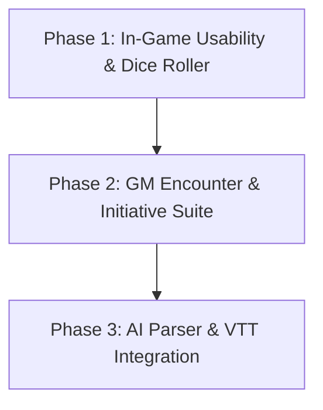

# 🐉 Pathfinder 1e Master Sheet & Monster Creator

Welcome to the **Pathfinder 1e Master Sheet & Monster Creator**! This is a powerful, offline-first, browser-based application designed specifically for Game Masters and Players of the Pathfinder 1st Edition Roleplaying Game.

It allows you to search a massive database of monsters, NPCs, spells, feats, weapons, and armors, customize their stats with built-in math automation, edit attacks in free-text (RAW) or calculation (CALC) modes, and export print-ready A4 statblocks and high-quality PNGs directly to your desktop.

---

## 🔍 Application Overview

This project is a feature-rich, **offline-first** Game Master (GM) and player assistant for the Pathfinder 1st Edition tabletop RPG. It combines embedded database libraries (monsters, spells, feats, gear) with real-time statblock generation, math calculation engines, and gold-bordered statblock export features.

---

## Present Features & Database Content (What's Included)

### 1. 📚 Comprehensive Embedded Library
- **6,549+ Monsters & NPCs (`data/monsters.json`):** Full Bestiary 1–6, NPC Codex, Unique Monsters, 3rd Party (3PP) creatures, and Custom Homebrew database.
- **2,909 Spells (`data/spells.json`):** Searchable by spell level, school, and class, integrated with Archives of Nethys pop-up modals.
- **3,188 Feats (`data/feats.json`):** Tag autocomplete, rule description popups, and automatic stat bonus calculations with enriched RAW mechanics.
- **321 Special Abilities & Universal Monster Rules (`data/special_abilities.json`):** Complete Paizo RAW mechanics, save DC formulas, and Bestiary 1-6 traits.
- **75 Monster & Spell Auras (`data/auras.json`):** Full mechanical descriptions for fear auras, elemental halos, holy/unholy shields, and planar emanations.
- **141 Class Features (`data/class_features.json`):** Complete abilities covering Core, Base, Hybrid, and Occult classes.
- **Official Rules & Conditions Database (`data/rules.json`):** Comprehensive rules covering 32 Combat Conditions, 11 Combat Maneuvers, Combat Modifiers, and Environmental Hazards.
- **21 Armors & Shields (`data/armor.json`):** Automatic calculation of Armor Class (AC), Max DEX limits, and Armor Check Penalty (ACP).
- **41 Weapons (`data/weapons.json`):** Datalist autocompletion with range, damage, and critical stats.
- **43 Immunities, 37 Resistances & 24 Weaknesses (`data/immunities.json`, `data/resistances.json`, `data/weaknesses.json`):** Complete monster defense and vulnerability profiles.

### 2. ⚔️ Dual-Mode Attack System (RAW & CALC)
- **RAW Mode (Free-Text):** Edit melee and ranged attacks freely in gold-framed textareas (e.g., `mwk rapier +13 (1d6+11/18-20)`).
- **CALC Mode:** Select weapons from the dropdown library, apply Masterwork toggles, and let the app auto-calculate attack bonuses, strength multipliers, and damage.
- **Seamless Toggle:** Switch between RAW and CALC modes at any time without losing typed text.

### 3. 🖥️ Collapsible 35% Sidebar & Responsive Statblock Centering
- **35% Panel Width:** The left editor panel occupies 35% of the viewport by default (`.controls-panel`).
- **Smooth Collapse & Centering:** Collapsing the sidebar slides the panel off-screen (`margin-left: -35%`), expanding the preview area to 100% width and automatically centering the gold-bordered monster sheet (`#statblock-paper`) dead-center in the browser window.
- **Visual Themes:** Over 20 built-in themes (Gold, Dark, Parchment, Arcane, High Contrast, etc.).

### 4. 🧮 Real-Time Math & Mechanics Engine
- **Live Stat Calculation:** Real-time updates for HP, Initiative, Saving Throws (Fort/Ref/Will), AC (Touch and Flat-Footed), BAB, CMB, and CMD based on ability scores.
- **SLA & Special Ability Formatting:** Automatic parsing and formatting for Spell-Like Abilities (`At will—...`, `3/day—...`, `1/day—...`).
- **Wondrous Item Bonuses:** Automatic attribute scaling for items like *Belt of Giant Strength* and *Belt of Incredible Dexterity*.

### 5. 📸 Exporting Capabilities
- **Native High-Res PNG Export:** One-click `#btn-export-png` button renders gold-framed statblocks directly to your Desktop via `html2canvas`.
- **JSON Import/Export:** Save custom monsters to local JSON files and reload them into the editor at any time.

## ❌ System Limitations & Missing Features (What's Missing)

1. **🎲 Interactive Dice Roller:** Clickable dice expressions on statblocks (e.g. clicking `+13`, `1d6+11`, or `Fort +8`) to roll animated 3D or pop-up dice results are not yet implemented.
2. **🩸 Dynamic Condition Tracker:** Toggleable combat condition status effects (*Grappled*, *Sickened*, *Prone*, *Entangled*, *Blinded*) that dynamically adjust AC, attack penalties, and speeds in real-time are missing.
3. **⚔️ Encounter Builder & Initiative Tracker:** Multi-creature combat management for tracking initiative order, party APL / XP budgets, and active HP depletion is not yet built.
4. **📊 Automated Skill Point Allocation:** Class skill bonuses (+3) and Intelligence-based skill point limits are currently entered manually.
5. **📜 Plain-Text Statblock Parser:** A tool to paste raw statblock text from Paizo PDFs or Archives of Nethys and auto-parse it into editor fields is missing.
6. **🌐 Virtual Tabletop (VTT) Export:** Direct export into Foundry VTT actor `.json` schemas or Roll20 attribute mappings is not yet present.
7. **🧪 Live Resource & Spell Slot Tracker:** Interactive decrement counters for tracking expended spell slots and daily SLA uses (`3/day` -> `2/day`) during sessions are missing.

---

## 🚀 Enhancement Roadmap & How to Improve

The proposed 3-phase development roadmap for upgrading the application:



### 📍 Phase 1: In-Game Tools (Short-Term)
- [ ] **Interactive Dice Roller:** Make attack bonuses, damage formulas, and save modifiers clickable to roll dice with critical hit highlights.
- [ ] **Quick Condition Toggles:** Add toolbar buttons for *Grappled*, *Prone*, *Sickened*, *Entangled* that instantly recalculate stats.
- [ ] **Creature Template Engine:** Implement 1-click template application (*Fiendish*, *Celestial*, *Skeleton*, *Zombie*, *Vampire*, *Lich*).

### 📍 Phase 2: GM Combat & Encounter Suite (Medium-Term)
- [ ] **Encounter Builder & XP Budgeting:** Select multiple creatures from the database to compute total Encounter CR, difficulty, and XP rewards.
- [ ] **Live Initiative & HP Tracker:** A GM dashboard to track turn order, current vs. max HP, and active status for combat encounters.
- [ ] **Multi-Card Printable PDF Layout:** Export multiple compact monster cards onto a single print-ready A4 PDF page.

### 📍 Phase 3: Automation & Ecosystem Integration (Long-Term)
- [ ] **Statblock Text Parser:** Parse raw plain-text statblocks copied from PDFs or websites directly into editor inputs.
- [ ] **Foundry VTT & Roll20 Export:** Export custom statblocks into Foundry VTT PF1E Actor JSON files.
- [ ] **PWA / Offline Mobile Support:** Convert into a Progressive Web App (PWA) optimized for tablets and mobile devices.

---

## 🚀 Getting Started

This application is designed to be run locally on your machine with zero external internet dependencies required for core features.

### Prerequisites
- **Python 3.x** installed on your computer.

### Installation & Running

1. **Navigate to the project folder:**
   ```bash
   cd path/to/PATHGM
   ```
2. **Start the local server:**
   ```bash
   python main.py
   ```
3. **Open your web browser:**
   The application will automatically open in your default browser at:
   [http://localhost:8000](http://localhost:8000)

---

## 🛠️ How to Use

- **Creator / Editor (`index.html`):** Fill out stats on the left pane and watch the real-time A4 gold-bordered statblock update on the right. Click the top-left toggle button to collapse the sidebar and view the statblock centered in full-screen.
- **Database Browser (`database.html`):** Search by name, CR, alignment, environment, or category (Favorites, Customs, NPCs). Click **Load Custom (📝)** to import any monster directly into the editor.
- **Magic & Feat Tabs:** Add spells and feats via tag search. Click any spell or feat tag to open detailed rule popups.
- **Exporting:** Click **Export PNG** in the top bar to save a PNG image of your statblock.

---

## 📜 License & Credits

Built for the Pathfinder 1E community. Pathfinder is a registered trademark of Paizo Inc. Data sourced under the Open Game License (OGL).

