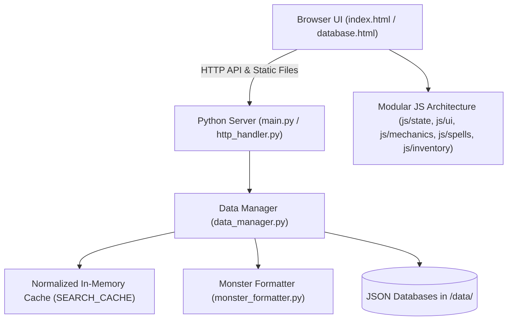

# 🐉 PathMonsterDB Memory Bank

Comprehensive system architecture, database schema, operational workflows, and codebase documentation for **PathMonsterDB (Pathfinder 1e Master Sheet & Monster Creator)**.

---

## 🏛️ 1. System Architecture Overview

PathMonsterDB is an offline-first, high-performance web application designed for Game Masters and players of the Pathfinder 1st Edition Roleplaying Game. It couples a lightweight Python HTTP backend with a modular vanilla JavaScript frontend and pre-indexed JSON databases.



---

## 📂 2. Database Structure & Content (`/data`)

The application is backed by indexed and enriched JSON datasets:

| Dataset | Entries | Description |
|---|---|---|
| **`monsters.json`** | 6,516 | Official Paizo Bestiaries 1–6, NPC Codex, Unique Monsters, and Tome of Horrors (3PP). |
| **`custom_monsters.json`** | 29+ | User-created and customized monsters with state persistence. |
| **`spells.json`** | 2,909 | Complete Pathfinder 1e spell database with school, class spell lists, CL, and descriptions. |
| **`feats.json`** | 3,188 | Feat library with enriched RAW descriptions, prerequisites, and automatic stat modifiers. |
| **`special_abilities.json`** | 321 | Universal Monster Rules (UMR), special attacks, defenses, qualities, and traits with DC formulas. |
| **`auras.json`** | 75 | Monster and spell auras with radius and saving throw mechanics. |
| **`class_features.json`** | 141 | Core, Base, Hybrid, and Occult class features. |
| **`rules.json`** | 4 sets | 32 Combat Conditions, 11 Combat Maneuvers, Combat Modifiers, and Environmental Hazards. |
| **`armor.json`** | 21 | Armor & Shield stats (AC bonus, Max Dex, ACP, Spell Failure). |
| **`weapons.json`** | 41 | Weapons with damage dice, crit ranges, damage types, and categories. |
| **`magic_items.json`** | 58 | Big Six and wondrous items with slot mapping and attribute modifiers. |
| **`immunities.json`** | 43 | Condition and damage type immunities. |
| **`resistances.json`** | 37 | Energy and special resistances. |
| **`weaknesses.json`** | 24 | Vulnerabilities and mechanical weaknesses. |

---

## ⚙️ 3. Backend Architecture (`/server`)

### `server/data_manager.py`
- **In-Memory Loading & Global Indexing:** Loads official and custom monsters at startup into `GLOBAL_MONSTERS` with pre-computed lowercase query keys (`_m_name`, `_m_cr`, `_m_type`, `_m_align`, `_m_env`, `_m_source`).
- **Normalized Query Caching:** `SEARCH_CACHE` uses normalized query parameter strings (stripping timestamp cache-busters like `_t`) to prevent memory leaks and ensure high cache-hit rates.
- **Search Filtering & Sorting:** Multi-parameter search by Name, CR, Type, Alignment, Environment, Category (Official, NPC, Custom, Favorites, 3PP), and sorting (Alphabetical, CR Asc/Desc, Newest).
- **CRUD Operations:** Full lifecycle for custom monsters (`save_monster_from_json`, `delete_monster`, `toggle_favorite`) with atomic disk writes to `data/custom_monsters.json`.

### `server/http_handler.py`
- **Lightweight Multi-threaded HTTP Server:** Custom `SimpleHTTPRequestHandler` subclass with support for UTF-8 static file streaming (`.html`, `.js`, `.css`, `.json`, `.png`, `.jpg`).
- **REST Endpoints:**
  - `GET /api/search` - Paginated monster search with instant query results.
  - `GET /api/spells` - Fast autocomplete and search across all 2,909 spells.
  - `POST /api/save` - Save/update custom monster state.
  - `POST /api/delete/<idx>` - Delete custom monster.
  - `POST /api/favorite/<idx>` - Toggle monster favorite status.
  - `GET /api/scrape_status` - Health check.

### `server/monster_formatter.py`
- **Bidirectional State Formatting:** Transforms raw form data (`in-name`, `in-cr`, `in-str`, `in-hd-amount`, dynamic attacks, etc.) into standard Paizo Bestiary format.
- **Numeric Sanitization:** Extracts clean HP integers (e.g., `"49"` from `"49 (7d12+21)"`), parses fractional CRs (`"1/2"` -> `0.5`), and auto-generates AC touch/flat-footed calculations.

---

## 🎨 4. Frontend Architecture

### Modular Script Hierarchy
```
index.html / database.html
 ├── js/state.js       (CharacterState, inventory, magic item modifier stacking rules)
 ├── js/ui.js          (Tab switching, responsive layouts, window.showInfoModal lookup)
 ├── js/mechanics.js   (Spell level grouping, descending sorting, class-aware level resolution)
 ├── js/spells.js      (Spell search, autocomplete tags, interactive popups)
 ├── js/inventory.js   (Armor auto-fill, weapons catalog, Big Six magic item equipment)
 ├── script.js         (Main creature builder, live calculation engine, RAW/CALC attacks, auto-save)
 └── database.js       (Database browser, filters, pagination, theme synchronization)
```

### Key UI Features
1. **Interactive Info Modals (`window.showInfoModal`):**
   - Clickable badges and links for Feats, Spells, Auras, Special Abilities, Immunities, Resistances, and Weaknesses.
   - Searches `window.allSpecialAbilitiesDB`, `window.allAurasDB`, `window.allImmunitiesDB`, `window.allResistancesDB`, `window.allWeaknessesDB`, `window.allFeatsDB`, `window.allSpellsDB`, `window.allMagicItemsDB`.
   - Scrollable dialog with responsive max-height constraints.

2. **Dual-Mode Attack System (RAW vs. CALC):**
   - **RAW Mode:** Free-text editing with automatic Power Attack, Furious Focus, and Improved Critical parsing.
   - **CALC Mode:** Structured item selection from `data/weapons.json` with auto-computed attack bonuses and Strength scaling.

3. **Live Auto-Calculation Engine:**
   - Real-time computation of Ability Modifiers, Hit Points (with Con/Cha and Toughness), Armor Class breakdown, Saving Throws (with Great Fortitude, Iron Will, Lightning Reflexes), Base Attack Bonus (BAB), Combat Maneuvers (CMB/CMD), and Caster Level (CL).

4. **Big Six Magic Item Equipment Engine (`js/inventory.js`):**
   - Dedicated slots for Neck (Amulet of Natural Armor), Ring (Ring of Protection), Shoulders (Cloak of Resistance), Belt (Physical stats), Headband (Mental stats), and Wrists (Bracers of Armor).
   - Enforces bonus stacking rules according to Pathfinder 1e RAW.

5. **Theme Engine & LocalStorage Persistence:**
   - Over 20 custom CSS themes (Default, Classic, Dark, Parchment, Arcane, Emerald, Cyberpunk, etc.).
   - Seamlessly shared across editor and database pages via `localStorage.getItem('pf_creator_theme')`.

### 4.6 Interactive Steppers & Free-Form Combat Modifiers
- **Extra HP Stepper Suite (`in-hp-extra`):**
  - Integrated with live average HP calculation: `avgHp = Math.floor(hdAmt * ((hdSize / 2) + 0.5)) + hpBonus + hpExtra`.
  - Tactile quick-step adjustment buttons: `[-10]`, `[-5]`, `[-1]`, `[+1]`, `[+5]`, `[+10]`, and `[↺ 0]`.
- **Editable CMB & CMD Controls (`in-cmb`, `in-cmd`, `in-cmb-extra`, `in-cmd-extra`):**
  - No longer locked/disabled: supports both auto-calculated rules math and free-text custom notation (e.g. `+12 (+16 grapple)` or `24 (28 vs trip)`).
  - Modifier steppers: `[-2]`, `[-1]`, `[+1]`, `[+2]`, and `[↺ Reset]`.
- **100% English Localization:**
  - All UI elements, modal dialogs, font settings, button tooltips, and JS messages fully localized to standard idiomatic English.

---

## 🧪 5. Verification & Testing

The verification test suite (`python test_all.py`) ensures 100% system integrity across:
1. Static Asset Delivery & HTTP MIME Types.
2. JSON Schema & Parsing Integrity for all 12 datasets.
3. Monster Search, Filtering, and Indexing.
4. Spell Search & Cache Key Normalization.
5. Statblock Formatting & CR/HP Formula Extraction.
6. Full CRUD Lifecycle (Create, Read, Update, Favorite, Delete).
7. Live HTTP Server Response verification.

---

## 🚀 6. How to Run

```bash
# Start the local server and launch the app in your default browser
python main.py

# Run all verification tests
python test_all.py
```
Default server address: `http://localhost:8000` (or `http://127.0.0.1:8000`).
