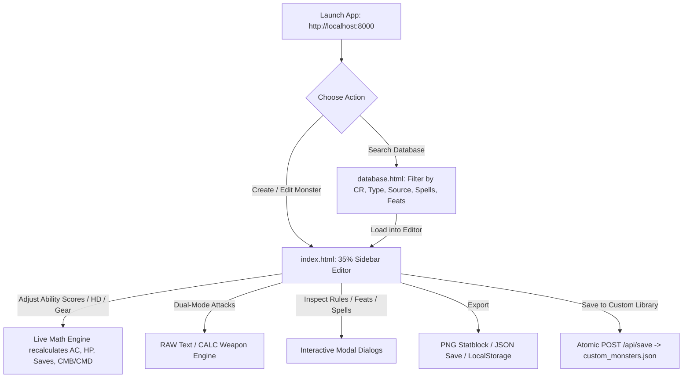

# Product Requirements & Context (PRD)

## 📌 Project Purpose & Vision
**PathMonsterDB** is an offline-first, high-performance web application and digital toolkit designed for Game Masters (GMs) and players of the **Pathfinder 1st Edition Roleplaying Game (PF1e)**. 

### Problem Statement
Running or preparing a Pathfinder 1e campaign is notoriously complex due to the sheer volume of rules, statblock math, spell lists, feats, and universal monster rules (UMR). Existing tools often require constant internet access, suffer from slow interfaces, lock stats into inflexible templates, or lack comprehensive databases covering Bestiaries 1 through 6, NPC Codex, and 3rd-party content.

### Solution
PathMonsterDB provides:
1. **Instant Offline Database Search:** Lightning-fast search across 6,549+ monsters, 2,909 spells, 3,188 feats, and hundreds of universal rules with zero internet requirement.
2. **Dynamic Live Statblock Generator:** A responsive Paizo-style monster statblock that automatically recalculates Base Attack Bonus (BAB), Combat Maneuver Bonus/Defense (CMB/CMD), Armor Class (Touch/Flat-Footed), saving throws, caster levels, and hit points in real-time.
3. **Dual-Mode Attack Editing:** Support for both automated calculated attacks (CALC) and free-form RAW text editing.
4. **Desktop Publishing & Export:** One-click high-resolution PNG export (gold-bordered A4 format) and JSON backup/restore.

---

## 👥 Target Audience & User Personas

### 1. Game Masters (GMs) in Active Sessions
- **Need:** Rapid stat lookups, on-the-fly monster scaling, HP and modifier adjustments during combat.
- **Workflow:** Search creature -> Adjust CR/HD/Abilities -> Reference spell/feat modals -> Run combat encounter.

### 2. Campaign Builders & Homebrewers
- **Need:** Craft custom creatures, apply monster templates, equip magic items, and generate authentic Pathfinder statblocks.
- **Workflow:** Load baseline monster or create from scratch -> Modify stats, attacks, special abilities -> Save to custom monsters library -> Export high-res PNG.

### 3. Players & Monster Companions
- **Need:** Manage animal companions, eidolons, summons, or polymorphed forms with accurate math and formatted attack lines.

---

## 🎯 Core User Flows

---

## 📦 In-Scope / Present Features

- [x] **Comprehensive Offline Datasets:**
  - 6,549+ Monsters & NPCs (`data/monsters.json`, `data/custom_monsters.json`)
  - 2,909 Spells (`data/spells.json`) with class spell lists, school, descriptors
  - 3,188 Feats (`data/feats.json`) with auto-modifying hooks and RAW text
  - 321 Special Abilities & Universal Monster Rules (`data/special_abilities.json`)
  - 75 Auras (`data/auras.json`), 141 Class Features (`data/class_features.json`)
  - 43 Immunities, 37 Resistances, 24 Weaknesses, 41 Weapons, 21 Armors, 58 Magic Items
  - 32 Combat Conditions, 11 Combat Maneuvers, Environmental Hazards (`data/rules.json`)
- [x] **Live Calculation Engine:**
  - Automatic ability modifiers, HD average calculation, Toughness/Con/Cha HP scaling.
  - Armor Class breakdown (Armor, Shield, Dex, Size, Natural, Deflection, Dodge, Touch, Flat-Footed).
  - Saving Throws (Base + Ability + Feats like Iron Will, Great Fortitude, Lightning Reflexes + Magic Items).
  - CMB / CMD calculations with free-form modifier support and quick-step buttons.
- [x] **Dual-Mode Attack System:**
  - **RAW Mode:** Free-text editing with automatic critical and modifier parsing.
  - **CALC Mode:** Dropdown weapon catalog with strength multipliers, masterwork toggles, and multi-attack scaling.
- [x] **Interactive Info Modals (`window.showInfoModal`):**
  - Clickable badges and links for Feats, Spells, Auras, Special Abilities, Immunities, and Items.
- [x] **Customization & Themes:**
  - Over 20 custom CSS themes (Gold, Classic, Dark, Parchment, Arcane, Cyberpunk, etc.) synced across pages via `localStorage`.
- [x] **Export Capabilities:**
  - High-res PNG export of gold-bordered statblocks via `html2canvas`.
  - JSON custom monster import/export.
- [x] **Python Backend:**
  - Lightweight multi-threaded HTTP server with zero pip dependencies.
  - Normalized query caching (`SEARCH_CACHE`) and atomic JSON file writing.

---

## 🚫 Out of Scope (Explicit Non-Goals)

To prevent scope creep and maintain system reliability, the following features are strictly **Out of Scope** for current development iterations:

1. **Heavy Frontend Frameworks (React, Vue, Next.js, Redux):**
   - The application MUST remain pure Vanilla HTML5, CSS3, and ES6+ JavaScript. Do not introduce build steps (Webpack/Vite), npm node_modules bundles, or frontend framework runtimes.
2. **Third-Party Cloud Services & External Databases:**
   - No external SQL databases (PostgreSQL/MySQL), cloud storage (AWS S3/Supabase), or external authentication (OAuth/Firebase). The app must remain 100% functional offline on localhost.
3. **Full Virtual Tabletop (VTT) Simulation:**
   - PathMonsterDB is a statblock creator and rules assistant, NOT a 3D battle map, token physics simulator, or real-time WebRTC multi-player platform.
4. **Automated Rule Breaker / Character Enforcement Engine:**
   - Do not strictly block user homebrew combinations that violate RAW (Rules As Written). Provide calculations, but allow free-text overrides for GM discretion.
5. **Python Pip Package Dependencies:**
   - The backend MUST run exclusively on Python 3 Standard Library modules (`http.server`, `urllib`, `json`, `os`, `threading`, `socketserver`). Do not introduce Flask, Django, FastAPI, SQLAlchemy, or requests.
