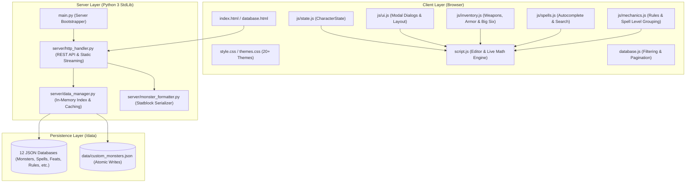

# System Patterns & Architecture

## 🏛️ 1. Architecture Overview

PathMonsterDB follows a clean, decoupled, offline-first client-server architecture:

---

## 📜 2. Frontend Modular Structure & Responsibilities

### Module Directory (`js/`)
1. **`js/state.js`**:
   - Manages the global `CharacterState` object.
   - Handles equipment slot assignments (Big Six magic items, weapons, armor).
   - Manages bonus stacking rules according to Pathfinder 1e RAW (enhancement, deflection, resistance, natural armor).
2. **`js/ui.js`**:
   - Controls panel collapsing (35% sidebar toggle), tab switching, and statblock centering.
   - Provides the centralized `window.showInfoModal(type, key)` dialog engine that queries loaded database caches and displays structured rule popups.
3. **`js/mechanics.js`**:
   - Handles spell level grouping (organizing spells into 0th through 9th level buckets).
   - Computes class-aware spell DC adjustments and modifier conversions.
4. **`js/spells.js`**:
   - Manages spell search datalists, tag autocomplete, and instant modal lookup integrations.
5. **`js/inventory.js`**:
   - Manages weapon selection catalogs, masterwork calculations, and Armor Class penalty matrices.

### Root Scripts
- **`script.js`**: Main monster creator engine. Listens to input events, executes real-time stat calculations (HP, AC, BAB, Saves, CMB/CMD, Abilities), handles dual-mode attack switching (RAW vs. CALC), and manages export routines.
- **`database.js`**: Powers `database.html`. Handles multi-faceted filtering, sorting, pagination, and synchronous theme loading.

---

## ⚙️ 3. Backend Architecture (`server/`)

### `server/data_manager.py`
- **Global In-Memory Indexing:** Loads `data/monsters.json` and `data/custom_monsters.json` once during startup into `GLOBAL_MONSTERS`. Pre-computes normalized lookup attributes (`_m_name`, `_m_cr`, `_m_type`, `_m_align`, `_m_env`, `_m_source`).
- **Normalized Query Caching:** `SEARCH_CACHE` dictionary maps sorted query strings (excluding volatile cache-busters like `_t`) to cached result slices.
- **Thread-Safe Atomic File I/O:** Serializes updates to `data/custom_monsters.json` using temporary file writes followed by atomic replace operations.

### `server/http_handler.py`
- Subclasses Python's `SimpleHTTPRequestHandler`.
- Routes `/api/search`, `/api/spells`, `/api/save`, `/api/delete/<idx>`, `/api/favorite/<idx>`, and `/api/scrape_status`.
- Streams static files (`.html`, `.js`, `.css`, `.json`, `.png`, `.jpg`) with explicit UTF-8 and correct MIME headers (`application/javascript`, `text/css`, etc.).

### `server/monster_formatter.py`
- Transforms raw form input dictionaries into official Paizo Bestiary format.
- Sanitizes numbers, calculates CR fractions (`"1/2"` -> `0.5`), parses HP formulas (`"49 (7d12+21)"`), and builds defensive/offensive stat blocks.

---

## 📐 4. Coding & Naming Standards

### JavaScript (ES6+)
- **Style:** Vanilla ES6+, no external runtime bundlers.
- **Variables & Functions:** `camelCase` (e.g., `calculateArmorClass()`, `updateSaveModifiers()`).
- **Global Handlers:** Prefixed with `window.` when cross-module access is required (e.g., `window.showInfoModal`, `window.allFeatsDB`).
- **DOM Element IDs:** `kebab-case` with functional prefixes (e.g., `in-str`, `in-hp-amount`, `btn-export-png`, `btn-toggle-sidebar`).
- **Data Attributes:** `data-*` attributes for dynamic lookups (e.g., `data-spell-name`, `data-feat-key`).

### CSS & Themes
- **Style:** Vanilla CSS3 using custom properties (`--gold-primary`, `--bg-card`, `--text-main`).
- **Layout:** Flexbox and CSS Grid. Responsive 35% control panel (`.controls-panel`) with smooth margin transitions for collapse states.
- **Themes:** Encapsulated in `themes.css` under `[data-theme="theme-name"]` selectors.

### Python
- **Style:** PEP 8 compliance.
- **Standard Library Only:** Exclusively use Python 3 built-in modules (`http.server`, `urllib.parse`, `json`, `os`, `sys`, `threading`).
- **Encoding:** Explicit `encoding="utf-8"` on all file operations.
- **Functions & Variables:** `snake_case` (e.g., `format_monster_from_state()`, `search_monsters()`).

---

## 🛡️ 5. State Management & Error Handling Patterns

1. **Single Source of Truth for Character State:**
   - The DOM inputs reflect the active monster state, backed by `CharacterState` for complex equipment and stacking modifiers.
2. **Defensive Parsing:**
   - Any numerical input must use `parseInt(val, 10) || 0` or `parseFloat(val) || 0` to prevent `NaN` cascading.
3. **Graceful Backend Error Handling:**
   - All API endpoints return structured JSON with `{ "success": false, "error": "Reason" }` on failure with appropriate HTTP status codes (400, 404, 500).
4. **Modal Fallbacks:**
   - `window.showInfoModal` checks multiple fallback keys and cleans punctuation before failing, ensuring reliable lookups even with variant naming.
